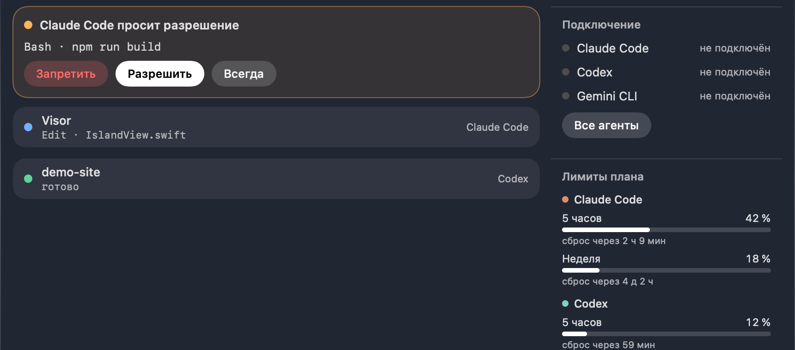
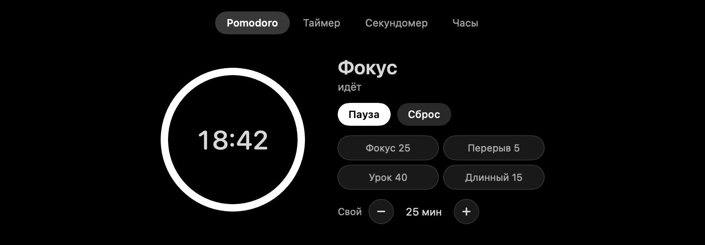

# Visor

Остров в вырезе MacBook. Показывает, что делают ваши ИИ-агенты, играет музыку с текстом песен, ведёт таймеры, календарь и буфер обмена, а ещё умеет не давать Mac засыпать при закрытой крышке. Бесплатно, с открытым кодом. Интерфейс на русском. macOS 15 и новее.






<!-- Сюда хорошо добавить снимки настоящего экрана: остров в вырезе, плеер, Awake. -->

## Что умеет

- **Агенты.** Статус Claude Code, Codex, Gemini CLI и Qwen Code в вырезе. Запрос разрешения приходит в остров, отвечаете там же. Лимиты плана, звуки событий. Любого другого агента с хуками можно подключить вручную.
- **Плеер.** Spotify и Apple Music: обложка, перемотка, лайк, плейлисты, текст песен с подсветкой строки. Песня с телефона видна на Mac.
- **Awake.** Mac не засыпает при закрытой крышке, пока вы не скажете: таймер, порог заряда, энергосбережение, заморозка лишних программ, переход на хотспот iPhone, если пропал Wi-Fi.
- **Планы и время.** Календарь (Google, iCloud, Exchange, подписки .ics), дела, таймер, секундомер, Pomodoro, мировые часы.
- **Чат.** 10 моделей по вашим ключам: Claude, Gemini, OpenAI, DeepSeek, Qwen, Mistral, Groq, Grok, OpenRouter, Kimi.
- **Остальное.** Буфер обмена с историей, полка для файлов и фото, калькулятор с курсами валют, диктовка голосом, Dev-панель (порты, GitHub, Vercel, система).
- Правый клик по острову: спрятать глазок или таблетку, поменять их местами, выбрать, что показывать.

## Установка

Нужен Mac с macOS 15 или новее. Лучше с вырезом, но остров работает и без него.

### Одной командой (рекомендуется)

```bash
curl -fsSL https://raw.githubusercontent.com/beks0928/visor/main/scripts/install.sh | bash
```

Скрипт скачивает последнюю версию, проверяет контрольную сумму, кладёт Visor в «Программы» и запускает. Файл скачивается через `curl`, поэтому macOS не показывает предупреждение «нельзя проверить разработчика».

### Образом `Visor.dmg`

1. Скачайте `Visor.dmg` со [страницы релизов](../../releases), откройте и перетащите Visor в «Программы».
2. Если macOS не открывает программу («нельзя проверить разработчика»), нажмите на неё правой кнопкой, «Открыть» и подтвердите. Либо один раз снимите метку карантина:

```bash
xattr -dr com.apple.quarantine /Applications/Visor.app
```

### Собрать самому

```bash
brew install xcodegen
git clone https://github.com/beks0928/visor.git && cd visor
scripts/install-local.sh
```

Скрипт собирает приложение, ставит в «Программы» и запускает. Подробности про подпись в начале `scripts/install-local.sh` и `scripts/release.sh`.

### Удаление

```bash
scripts/uninstall.sh
```

Убирает приложение, его данные, агента «не засыпать» и правило sudoers. Хуки агентов отключаются кнопкой в «Настройки → Агенты».

## Первый запуск

Visor ничего не делает без вашего разрешения и сам при входе в систему не запускается. Автозапуск включается в «Настройки → Основные → Запускать при входе в систему». Остров открывается наведением, кликом или клавишами Option+Пробел (сочетание меняется в настройках).

### Spotify

Лайки, плейлисты и песня с телефона идут через Spotify Web API и требуют **вашего собственного Client ID** (так делает любое приложение с открытым кодом):

1. На [developer.spotify.com/dashboard](https://developer.spotify.com/dashboard) создайте приложение. В «Redirect URI» впишите `http://127.0.0.1:8888/callback`.
2. В Visor: «Медиа → Музыка» (раздел поиска Spotify). Вставьте Client ID и Client Secret.
3. Нажмите «Войти в Spotify» и подтвердите все пункты в окне согласия.

С февраля 2026 Spotify требует Premium у владельца приложения в режиме разработчика и ограничивает число пользователей. Для одного человека этого достаточно. Если что-то отвечает ошибкой, Visor пишет её причину на экране, а запросы (без токенов) лежат в `~/Library/Application Support/Visor/spotify.log`.

### Агенты

«Настройки → Агенты» → «Подключить» у нужного агента. Перед записью Visor показывает, что изменится, и делает копию файла настроек. Чужие хуки не трогаются. Во вкладке «Агенты» видны три выбранных агента, остальные лежат в настройках. Для другого агента есть готовая команда хука там же.

### Awake (при закрытой крышке)

Работает как Insomnia: команда `pmset -a disablesleep`. Для неё нужно правило sudoers, которое разрешает без пароля четыре команды `pmset` (`disablesleep 1|0` и `lowpowermode 1|0`). Кнопка «Разрешить без пароля» в «Настройки → Awake» ставит его после запроса пароля macOS, один раз. Правило проверяется утилитой `visudo` перед записью. Если Insomnia уже установлена, её правило подходит для режима «не засыпать».

Закрытый Mac в работе греется: ставьте его на твёрдую поверхность, не в сумку.

## Что просит доступ

| Доступ | Зачем | Когда спросит |
|---|---|---|
| Календарь | Планы и ближайшая встреча | Кнопка «Разрешить доступ» во вкладке «Планы» |
| Микрофон и распознавание речи | Диктовка | Кнопка микрофона |
| Автоматизация | Трек и кнопки Музыки и Spotify, вкладки браузеров | Вкладка «Медиа» |
| Геопозиция | Только чтобы macOS показала названия Wi-Fi сетей для хотспота. Места Visor не читает | Кнопка «Разрешить» в Awake |
| Пароль администратора | Правило sudoers для «не засыпать» | Кнопка «Разрешить без пароля» в Awake |
| Рабочий стол | Снимки экрана на полку | Первый снимок экрана |

## Что уходит в сеть

Остальное работает на вашем Mac. Аналитики и учётных записей нет.

- Курсы валют: open.er-api.com, раз в час.
- Перевод: Google Переводчик (неофициальный адрес), текст из поля перевода.
- Обложки и фото артистов: Deezer, название трека и артиста. Тексты песен: lrclib.net.
- Spotify: ваш аккаунт по вашему Client ID.
- Чат: сервис выбранной модели по вашему ключу.
- GitHub и Vercel: только по вашим токенам и только когда модуль включён.

Ключи и токены лежат в связке ключей macOS и никуда, кроме своего сервиса, не отправляются.

## Отзывы и ошибки

Нашли ошибку или хотите что-то добавить? [Создайте обращение](../../issues/new/choose): там две формы, «Ошибка» и «Идея». Версию Visor видно в «Настройки → Основные». Чем точнее описание и скриншот, тем быстрее починим.

## Сборка для раздачи

```bash
VISOR_SIGN_IDENTITY=- scripts/release.sh
```

Собирает `Visor.zip`, `Visor.dmg` и `SHA256SUMS` в `build/release` без нотаризации. Эти три файла нужно приложить к релизу на GitHub: `install.sh` читает именно их. С аккаунтом Apple Developer: `VISOR_SIGN_IDENTITY="Developer ID Application: Имя (TEAMID)" scripts/release.sh` подпишет и нотаризует образ, тогда предупреждений не будет и у скачанного браузером dmg.

## Лицензия

MIT, см. [LICENSE](LICENSE).
